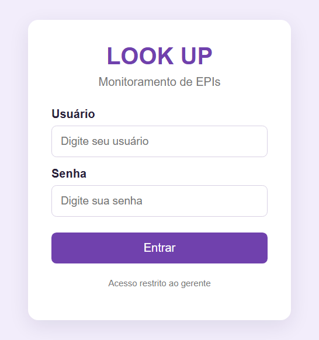
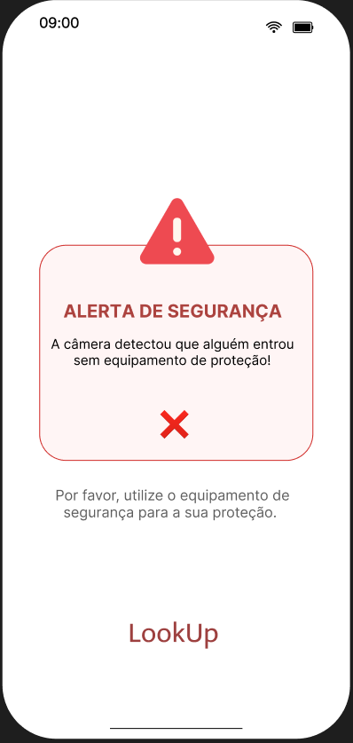
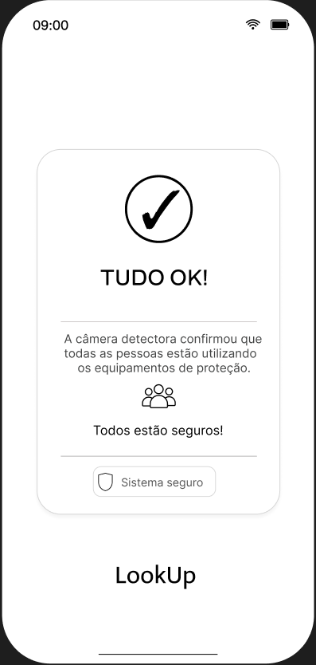
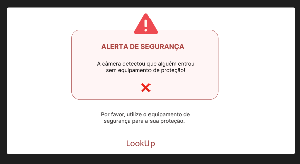
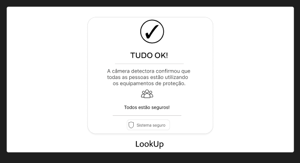

# 🦺 Look Up — Sistema Inteligente de Detecção de EPIs

## 📌 Sobre o Projeto

O **Look Up** é um projeto que utiliza visão computacional e Inteligência Artificial para detectar Equipamentos de Proteção Individual (EPIs) em ambientes de trabalho.

O sistema utiliza uma webcam para capturar imagens em tempo real e um modelo de IA para identificar pessoas e equipamentos de proteção. Além disso, possui uma aplicação web que permite acompanhar as detecções e visualizar alertas quando são identificadas situações de EPI incompleto.

A proposta é auxiliar o gestor no acompanhamento da segurança dos trabalhadores, facilitando a identificação de situações que precisam de atenção.

## 🎯 Objetivos

O principal objetivo é desenvolver uma solução capaz de identificar a presença de EPIs e informar quando uma pessoa não estiver utilizando os equipamentos de proteção necessários.

Os equipamentos considerados no projeto são:

- 🪖 Capacete de segurança;
- 🦺 Colete ou roupa de segurança;
- 🥽 Óculos de proteção;
- 🧤 Luvas;
- 😷 Máscara.

O projeto também busca oferecer uma interface simples para que o gestor possa acompanhar os resultados das detecções e consultar os alertas gerados pelo sistema.

## ⚙️ Tecnologias utilizadas

- **Python:** linguagem utilizada no desenvolvimento da aplicação e no processamento das imagens.
- **OpenCV:** utilizado para acessar a webcam e trabalhar com imagens e vídeos.
- **YOLO / Inteligência Artificial:** utilizado na detecção de pessoas e equipamentos de proteção.
- **HTML e CSS:** utilizados na construção e estilização da interface web.
- **Flask:** utilizado para disponibilizar a aplicação web em Python.

## 🖥️ Funcionalidades do sistema

- Captura de imagens por meio de uma webcam;
- Detecção de pessoas e EPIs utilizando Inteligência Artificial;
- Verificação dos equipamentos identificados;
- Identificação de situações em que os EPIs estão incompletos;
- Exibição das detecções na interface web;
- Geração e exibição de alertas para acompanhamento do gestor;
- Tela de login para acesso ao sistema.

Os resultados dependem da precisão do modelo de IA e das condições em que as imagens são capturadas, como iluminação, distância e posição da pessoa.

## 📸 Prints das principais telas

Esta seção será utilizada para apresentar capturas de tela da aplicação em funcionamento Web e Mobile.

### 1. Tela de login

<!-- Adicione aqui o print da tela de login. -->



### 2. Tela Mobile (Com Aviso)

<!-- Adicione aqui o print da tela principal com a webcam e as detecções. -->



### 3. Tela Mobile (Sem Aviso)

<!-- Adicione aqui o print mostrando a identificação dos equipamentos de proteção. -->



### 4. Tela Web (Com Aviso)

<!-- Adicione aqui o print mostrando os alertas de EPI incompleto. -->



### 5. Tela Web (Sem Aviso)

<!-- Adicione aqui o print da tela adicional. -->



## 🧩 Modelagem do projeto

Antes do desenvolvimento, foi realizada uma modelagem inicial para organizar a estrutura e o funcionamento da solução.

Essa etapa incluiu:

- Wireframes das interfaces;
- Desenvolvimento de protótipos iniciais;
- Definição da arquitetura inicial da solução.

## 🧪 Protótipos iniciais

Durante o desenvolvimento, foram testados três modelos de detecção para avaliar quais apresentavam melhores resultados na identificação dos EPIs necessários.

### Protótipo 1

O primeiro protótipo utilizou um modelo inicial de detecção de objetos integrado à webcam.

Nos testes, o modelo identificou principalmente o capacete de segurança, mas apresentou dificuldades para reconhecer outros equipamentos, como óculos, luvas e roupa de segurança.

**Resultado:** permitiu validar o funcionamento inicial da webcam integrada à Inteligência Artificial, mas apresentou limitações na detecção dos equipamentos.

### Protótipo 2

O segundo protótipo utilizou outro modelo de detecção de EPIs, apresentando melhorias em relação ao primeiro.

O modelo conseguiu identificar o capacete e a roupa de segurança, mas continuou apresentando dificuldades na identificação de óculos e luvas.

**Resultado:** apresentou evolução em relação ao primeiro protótipo, mas ainda não atendia completamente às necessidades do projeto.

### Protótipo 3

O terceiro protótipo utilizou um modelo YOLOv5 voltado para a detecção de Equipamentos de Proteção Individual.

Nos testes, foi possível identificar pessoas, capacetes, roupas de segurança, óculos de proteção e luvas. A detecção de máscaras apresentou inconsistências, e também foram observadas algumas classificações incorretas.

**Resultado:** foi o modelo que apresentou os resultados mais promissores entre os três protótipos iniciais e serviu como base para a continuidade do desenvolvimento.

### Comparação dos protótipos

| EPI / Objeto          | Protótipo 1                    | Protótipo 2                    | Protótipo 3       |
| --------------------- | ------------------------------- | ------------------------------- | ------------------ |
| Pessoa                | Não avaliado                   | Não avaliado                   | Identificado       |
| Capacete              | Identificado                    | Identificado                    | Identificado       |
| Roupa de segurança   | Dificuldades                    | Identificada                    | Identificada       |
| Óculos de proteção | Dificuldades                    | Dificuldades                    | Identificados      |
| Luvas                 | Dificuldades                    | Dificuldades                    | Identificadas      |
| Máscara              | Não identificada adequadamente | Não identificada adequadamente | Em testes iniciais |

> Os resultados correspondem aos testes iniciais realizados pela equipe. A identificação pode variar de acordo com as condições da imagem e o posicionamento dos equipamentos.

## 🏗️ Arquitetura da solução

O sistema utiliza uma webcam para capturar as imagens, um computador para processá-las e uma aplicação desenvolvida em Python integrada a um modelo de Inteligência Artificial.

Após a detecção, os resultados são utilizados pela aplicação para apresentar as informações na interface web e exibir alertas relacionados a EPIs incompletos.

Fluxo de funcionamento:

```text
             ┌─────────────────┐
             │     Webcam      │
             └────────┬────────┘
                      │
                      ▼
             ┌─────────────────┐
             │ Captura de      │
             │ imagens         │
             └────────┬────────┘
                      │
                      ▼
             ┌─────────────────┐
             │ Processamento   │
             │ em Python       │
             └────────┬────────┘
                      │
                      ▼
             ┌─────────────────┐
             │ Modelo de IA    │
             │ para detecção   │
             └────────┬────────┘
                      │
                      ▼
             ┌─────────────────┐
             │ Verificação dos │
             │ EPIs detectados │
             └────────┬────────┘
                      │
                      ▼
             ┌─────────────────┐
             │ Aplicação web   │
             │ e alertas       │
             └─────────────────┘
```

## 💻 Como executar o projeto

### 1. Abrir o projeto

1. Conecte a webcam ao computador.
2. Abra o Visual Studio Code.
3. Clique em **Arquivo → Abrir Pasta** e selecione a pasta principal `LookUp`.
4. Abra o terminal do VS Code em **Terminal → Novo Terminal**.

### 2. Preparar o Python (somente se necessário)

Verifique se o Python 3.12 está instalado:

```bash
py -3.12 --version
```

Caso o comando `pip` não esteja disponível, execute:

```bash
py -3.12 -m ensurepip --upgrade
```

Atualize o pip:

```bash
py -3.12 -m pip install --upgrade pip
```

### 3. Instalar as bibliotecas (somente na primeira configuração do computador)

Execute os comandos abaixo, um de cada vez:

```bash
py -3.12 -m pip install opencv-python
```

```bash
py -3.12 -m pip install flask
```

```bash
py -3.12 -m pip install torch torchvision
```

```bash
py -3.12 -m pip install ultralytics
```

```bash
py -3.12 -m pip install pandas
```

```bash
py -3.12 -m pip install pyyaml
```

### 4. Iniciar o sistema Look Up

Com o terminal aberto na pasta principal do projeto, entre na pasta `site_gerente`:

```bash
cd site_gerente
```

Agora execute a aplicação:

```bash
py app.py
```

Aguarde o carregamento do modelo de Inteligência Artificial e a conexão com a webcam.

### 5. Acessar o sistema

Quando o servidor iniciar, abra o navegador e acesse:

```text
http://127.0.0.1:5000/login
```

**Dados de acesso:**

- Usuário: `gerente`
- Senha: `123456`

### 6. Encerrar o sistema

Quando terminar de utilizar o projeto, volte ao terminal do VS Code e pressione:

```text
Ctrl + C
```

Isso encerra a execução do servidor.

### Observações importantes

- Os comandos de instalação das bibliotecas precisam ser executados apenas na primeira configuração do computador.
- Nos próximos usos, basta abrir o projeto, entrar na pasta `site_gerente` pelo terminal e executar `py app.py`.
- A webcam externa deve estar conectada antes de iniciar o sistema.
- O arquivo do modelo de IA deve permanecer na pasta `prototipo4`, com o nome `prototipo4_ppe.pt`.
- Enquanto o sistema estiver funcionando, o terminal precisa permanecer aberto.
## 📁 Organização dos arquivos

A estrutura pode variar conforme a organização atual do repositório. Uma sugestão para organizar os arquivos é:

```text
Look-Up/
├── app.py
├── index.html
├── README.md
├── prints/
│   ├── tela-login.png
│   ├── tela-principal.png
│   ├── deteccao-epis.png
│   └── alertas-epis.png
├── 1.png
├── 2.png
└── arquivos do modelo de IA
```

Essa estrutura é apenas ilustrativa. Mantenha os arquivos e as pastas nos locais em que realmente estão no seu repositório, especialmente os templates, os arquivos estáticos e os modelos de detecção.

## 🚧 Limitações e melhorias

Durante os testes, foram observadas limitações na identificação de alguns equipamentos, principalmente máscaras e luvas, além da possibilidade de classificações incorretas.

Entre os pontos que podem ser aprimorados estão:

- Melhorar a precisão na detecção dos EPIs;
- Reduzir falsos positivos e falsos negativos;
- Realizar testes em diferentes condições de iluminação e posicionamento;
- Aprimorar a apresentação dos alertas para facilitar o acompanhamento pelo gestor;
- Evoluir a solução conforme os requisitos do projeto.

## 👥 Equipe

Projeto acadêmico desenvolvido para estudar e aplicar conceitos de visão computacional, Inteligência Artificial e desenvolvimento de aplicações voltadas à segurança do trabalho.
